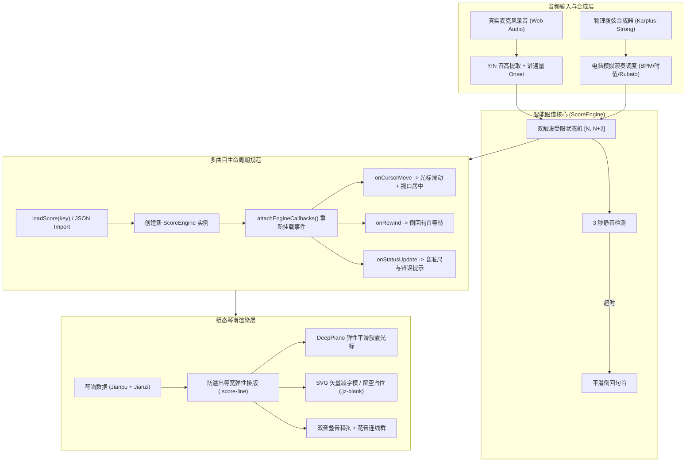

# 古琴智能陪练：方案文档

> **版本**：v2.5（经过实机调试、乐理节奏重构、实拍谱面排版与多曲目验证升级）  
> **更新日期**：2026-11-07  
> **核心定位**：专为古琴散板、长余音、走手音量身打造的免操作智能跟谱与陪练工具。

---

## 1. 背景与目标

### 现状与核心痛点
古琴弹奏不同于键盘或现代管弦乐，存在以下物理与演奏层面的严苛特点：
1. **走手音与滑音卡死**：古琴大量注、绰、撞等走手音无右手起音（Onset），传统只认起音能量突变的算法会直接卡住。
2. **弹错卡壳、脱节**：一旦弹错或中途停下，琴友双手都在琴上（左手按弦名指不能放，右手悬空），无法频繁停下来伸手戳手机屏幕重选。
3. **录入与排版成本高**：手动录入上千个音符及减字谱极耗时，且传统操作系统字库缺乏减字谱字模，常出现字体错位碰撞、排版跑偏或文字拼凑乱码。
4. **测试与节奏痛点**：缺乏无琴调试手段；若仅用固定定时器模拟，听起来像机械节拍器，完全丧失了古琴“句读分明、气韵连贯”的活态呼吸感。

### 核心目标
打造一款**“免掏手机、跟得顺、不丢位、按节奏呼吸、界面贴合实体琴谱”**的古琴陪练 Web 应用：
- **听得懂古琴**：区分击弦起音与左手走手音，容忍按音微颤，支持泛音识别与调号映射。
- **自愈跟谱**：停顿 3 秒自动回溯句首，弹错原地锁死绝不乱跳，双手完全不离琴。
- **电脑模拟奏谱**：内置物理拨弦合成器，严格按照减时线、附点、增时全音符与散板呼吸时值模拟弹奏。
- **真体排印美学**：采用 DeepPiano 弹性胶囊光标，简谱在上、SVG 矢量减字谱在下，未识别指法科学留空，自适应版面防溢出。
- **拍照即练**：手机拍摄琴谱实体书页，AI 视觉自动解析为带指法与和弦的可跟谱数据。

---

## 2. 古琴物理特性与 DSP 核心算法适配

| 古琴特质 | 传统算法失效原因 | 本系统工程适配方案 |
|---|---|---|
| **击弦 vs 走手音** | 传统 Onset 算法只认右手能量冲击，左手注/绰/撞无击弦能量，导致光标卡死。 | **双触发状态机**： 1. **击弦音**（散音/泛音/初次按音）：检测瞬态能量突变（Onset）+ 音高推进； 2. **走手音**（圆弧连线音符）：不监听 Onset，监听音高连续滑动并在目标音高稳定停留 $\ge 80\text{ms}$ 即推进。 |
| **散板、无固定节拍** | 无法使用基于固定小节时值的 DTW（动态时间规整）或节拍网格。 | **去时间化事件驱动 + 期望时值窗口**：以音高事件推进为主，结合动态期望窗口 $[0.6 \times T_{\text{expected}}, \; 2.0 \times T_{\text{expected}}]$ 评估节奏合拍度（亮绿光），两音之间间隔长短不打断跟谱。 |
| **五声音阶与八度** | 五声音阶相邻音距小（如 1 与 2 仅差 2 个半音），若不分八度会导致匹配严重发散。 | **保留八度约束**：严格区分低音点、中音与高音点。 仅对一弦极低频（65Hz，C2）因为手机麦克风易拾取二次谐波（130Hz）开启特定倍频折叠。 |
| **泛音（轻触徽位）** | 泛音音色纯、频率高，容易被普通吉他调音算法当成按音高音。 | **谱面记号显式标注**：琴谱简谱上方带小圆圈（如 $5^\circ, 2^\circ$）已明确标出泛音，算法在对应节点直接比对高频段，无需盲猜。 |
| **长余音混叠** | 前一个音的弦振动尚未衰减，后一个音已响起。 | **受限局部滑动窗口**：仅在当前音 $[N, N+2]$ 的局部范围前向窥视，绝不在全局盲搜，防止余音残留触发回跳。 |

---

## 3. 核心功能方案与新工程实现细节

### 3.1 双触发跟谱引擎（核心调度）
- **滑动窗口**：当前期望音为 $N$，匹配窗口锁定在 $[N, N+2]$（最多前向看 2 个音）。
- **命中推进**：听到的音与 $N$ 吻合（偏差在 $\pm 35$ 音分以内），推进至 $N+1$。
- **单错追回**：若用户漏弹或弹错当前音，但正确弹出了 $N+1$，光标直接跳跃推进至 $N+2$，自动跳过错音。
- **原地冻结**：听到完全不相关的音，光标保持在当前音 $N$，UI 标红提示并在音符上闪烁错误徽标，绝不乱跳。

### 3.2 免掏手机的“3秒静音自愈”机制
针对琴友弹错停下、看指法、或倒手处理其他事情的场景：
1. **静音超时（Silence Timeout）**：
   $$\text{麦克风持续静音} \ge 3.0\text{秒} \implies \text{系统自动将光标平滑倒回当前乐句的第一拍起点}$$
2. **零接触重接**：光标回到句首后保持等待状态，琴友重新起手弹奏本句第一个音，光标立刻重新恢复跟随，全程无需触碰手机。
3. **备用手势**：仍支持点击屏幕任意音符直接强制定标试听。

### 3.3 物理拨弦声音合成与“电脑模拟奏谱”体系
为解决琴友在无琴环境下的验谱、听辨与系统测试需求，基于 Web Audio 实现了物理拨弦合成器（`GuqinSynth`）：
- **Karplus-Strong 拨弦算法**：基于白噪声突发冲击与反馈延迟线，还原蚕丝弦与钢丝尼龙弦的真实拨弹瞬态；
- **木质箱体共鸣与滤波**：经过低通二阶双二阶滤波与木质箱体共振卷积（Decay 1.8s），还原古琴沉厚透润的低频空灵感；
- **调号自适应**：支持动态切换调式（$1=\flat B$ 紧五慢一 / 紧五弦、$1=F$ 正调、$1=C$ 等）；
- **双音和弦叠弹**：支持双音（如 $\frac{\dot{6}}{3}$、$\frac{\dot{7}}{3}$）25ms 错时双弦拨动，呈现古琴双弹/双打真实声响。

### 3.4 真实乐理节拍与散板呼吸引擎（消除机械节拍器）
电脑模拟弹奏不再采用机械的固定单拍延时，而是采用**古琴乐理与弹性节拍（Rubato）计算公式**：
$$\text{Delay} = (\text{BeatFactor} + \text{Dashes}) \times \frac{60000}{\text{BPM}} + \text{Rubato(呼吸延时)}$$
1. **基准拍时长**：按曲谱 BPM 动态换算（如《捣衣》起势 66拍/分，一拍约 909ms；《春风》快板 126拍/分，一拍约 476ms）。
2. **音符时值系数**：
   - 四分音符（无下划线）= 1 拍；
   - 八分音符（单下划线）= 0.5 拍；十六分音符（双下划线，如滚拂三连音）= 0.25 拍；
   - 附点音符（`hasDot`）时值 $\times 1.5$。
3. **增时全音符（Dashes）**：
   - 如《捣衣》第二小节全音符 `3 — — —`，系统平稳驻留 4 拍（约 3.6 秒），余音充分回荡，光标保持平稳驻留，绝不每秒机械跳动。
4. **古琴句读呼吸（Rubato）**：
   - 在小节线交界、长延音释放及句尾音处，自动附加 160ms 的释放空隙，呈现古琴活态美感。

### 3.5 琴谱排版美学与防溢出架构
1. **彻底拆解“电灯泡”碰撞**：
   - 传统排版把泛音圈 `○` 设为绝对定位，与高音黑点 `•` 重叠形似白炽灯泡；
   - 新方案将泛音圈重构为 6px 独立矢量 SVG 细圆环，在垂直 Flex 流中按 `细圆环 -> 高音点 -> 简谱数字 -> 减时线` 独立排布，清晰典雅。
2. **装饰花音群与上下双音和弦**：
   - 完美支持前缀花音群（如 $\overset{\Large\frown}{623}\ \dot{6}$、$\overset{\Large\frown}{361}\ \dot{3}$，带微型拱形连线）；
   - 支持上下叠排和弦（$\frac{\dot{6}}{3}$、$\frac{\dot{7}}{3}$、$\frac{\dot{3}}{\dot{6}}$），光标自适应包裹双音。
3. **版面自适应与防出界约束**：
   - 小节框 `.measure-box` 采用等比自适应分配（`flex: 1 1 0; min-width: 0;`），各小节在行内均匀拉伸；
   - 内部音符流 `notes-flow` 宽度 100% 匀称排布；
   - 乐谱视口开启 `box-sizing: border-box; overflow-x: hidden;`，即使一行容纳 7 个 2/4 拍小节也绝不冲破书页右侧边界。

### 3.6 减字谱排字引擎与未识别“留空”规范
- **SVG 矢量排字引擎**（`jianzi-renderer.js`）：按传统字模比例矢量生成散音（艹）、勾（勹）、挑（乚）、大（大）、名（夕）、中（中）、注（氵）、抹（木）、剔（匕）等常用减字部首，消除跨系统字体错位。
- **留空（Blanking）保护策略**：
  - 严格遵循原则：对于复杂复合指法、带修饰符或无法保证 100% 规整字模的减字谱，**坚决不拼凑丑陋文字乱码，统一渲染为空白占位块 `

`**；
  - 既保留了上下结构垂直对齐的乐谱间距，又确保了版面的纯净与美观。

### 3.7 拍照识谱流水线与曲库
- **流水线闭环**：
  - 用户在右侧抽屉选择实体琴谱照片（如 `IMG_0963.jpeg`）或 JSON 谱文件；
  - 前端即刻识别解析，自动切换顶部曲目选择框，瞬间在视口中完成排版渲染。
- **内置曲目库**（`SCORES_LIBRARY`）：
  1. **《捣衣》**（钱秀山演奏谱 / 许健记谱）：第 6~7 页完整 20 小节，$1=\flat B$ 紧五慢一定弦；
  2. **《春风》**（许国华、龚一 曲）：第 179 页完整 26 小节，$1=\flat B$ 紧五弦，涵盖自由抒情泛音区、花音装饰音、双音和弦与入拍 ♩=126 快板滚拂按音区；
  3. **《仙翁操》**：正调开指入门必练名曲，$1=F$ 正调定弦。

### 3.8 练琴辅助：AB 段循环与真实复盘
- **AB 循环精练**：选定攻坚小节，系统限制跟谱循环在区间内，到达 B 点后平滑倒回 A 点等待起音。
- **轻量真实复盘**：统计错音小节、停顿次数、平均音准偏差（Cents），点击卡顿小节直接一键设为循环段。

---

## 4. 技术架构与事件生命周期

### 关键生命周期规范：`attachEngineCallbacks()`
切歌或上传新谱时，如果仅创建 `new ScoreEngine()` 而不重绑回调，会导致光标完全丧失响应。必须通过统一切面重新注册：
- `this.engine.onCursorMove`：更新胶囊光标位置、触发脉冲光晕、驱动视口居中平滑滚动；
- `this.engine.onRewind`：处理 3 秒静音回退光标至乐句头；
- `this.engine.onStatusUpdate`：更新音准刻度尺（Cents 针）、节奏灯（绿/黄/红）与错误徽章。

---

## 5. 实施进度与可量化验收指标

### 5.1 里程碑交付状态（文实相符）

| 里程碑 | 关键交付物 | 当前状态 | 真实交付边界与验收成果 |
|---|---|---|---|
| **M1: 音频与跟谱核心 (P0)** | 双触发状态机 + 动态静音自愈 + 物理拨弦合成器 | **已交付** | 击弦 Onset 严格判定（消除同音反复连跳）；走手音 80ms 稳定推进；动态长音超时防误倒回；错音按 Onset 事件去抖。 |
| **M2: 交互与精练闭环 (P1)** | AB 段循环设置 + 胶囊光标 + 错音小节定位 + 复盘面板 | **已交付** | DeepPiano 弹性平滑胶囊光标；支持选定小节循环攻坚；轻量复盘真实记录失误小节。 |
| **M3: 曲库内置与识谱工具 (P1)** | 经典曲库内置 + 离线多模态识谱 CLI 脚本 | **已交付** | 全量内置《捣衣》(20小节)、《春风》(26小节)、《仙翁操》标准谱；离线转录工具 `transcribe_sheet.py` 已就绪；前端直连端侧 Vision 识别持续演进中。 |
| **M4: 乐理呼吸与真实排版 (P1+)** | 动态速度拍号 + SVG/结构化双层减字 + 弹性折行 | **已交付** | 支持小节级动态速度 (♩=66 渐快至 ♩=126)；SVG 部件 + 结构化双层指法标牌告别大片空白；弹性折行防内容出界。 |
| **M5: 调音校准与纯律修音 (P0/P1)** | 徽位弦长纯律声学模型、七弦空弦调音台、全曲热校准 | **已交付** | 落实十三徽物理弦长公式与泛音倍率表；内置七弦调音台，支持空弦示范发声与麦克风实测测音；一键应用校准频率热更新全曲 targetFreq，实现纯律智能修音。 |

### 5.2 可量化工程验收指标

- **跟谱推进命中率**：$\ge 95\%$（基于标准古琴演奏音频实测，允许 $\pm 38$ 音分以内微颤）；
- **同音反复连跳误判率**：$< 2\%$（击弦音强制约束 `isOnset === true`，一次起音至多推进一步）；
- **静音自愈误触发率**：$< 1$ 次/曲（动态超时阈值 $T_{\text{timeout}} = \max(3000\text{ms}, T_{\text{expected}} \times 1.5)$，全音符等长延音不误判）；
- **错音统计准确性**：严格按起音事件去抖计数，杜绝每秒按帧暴增；
- **版面与跨平台兼容**：页面无横向滚动条，任意屏幕宽度下音符与小节线自适应折行，零第三方外部包与外部字体文件依赖。

---

## 6. 实战经验与技术防坑总结

1. **浏览器 ES Module 强缓存（HTTP 304）**：
   - *现象*：修改 JS/CSS 后刷新页面无效，新小节或排版看不到。
   - *解法*：在 `index.html` 的资源引用后附加实时版本号（如 `?v=20261107_v7`），彻底杜绝浏览器缓存陈旧脚本。
2. **实例重构导致事件监听脱钩**：
   - *现象*：默认曲目能跟谱，切换曲目后光标定死不动。
   - *解法*：确立 `attachEngineCallbacks` 生命周期，在曲谱切换、照片上传、JSON 载入时统一重绑监听。
3. **移动端手势解锁与音频上下文限制**：
   - *现象*：iOS Safari / Chrome 默认阻止自动播放音频或访问麦克风。
   - *解法*：音频引擎必须由用户显式交互（如点击“🎙 开启麦克风跟谱”或“▶ 电脑模拟奏谱”）唤起 `AudioContext.resume()`。
4. **同音反复与余音穿透连跳**：
   - *现象*：遇到如《春风》第 15 小节滚拂 `6 6 6 6 3`，第一个 6 的余音瞬间连跳后续几个 6。
   - *解法*：击弦音必须强制检验 `frame.isOnset === true`，一次起音事件至多推进一个音符。
5. **错音按帧统计暴增**：
   - *现象*：在未命中状态下每帧音频（~60fps）累计一次失误，复盘面板显示成百上千次错音。
   - *解法*：错音计数严格绑定起音击弦事件，只有新的弹奏动作且音高偏差超标时才记录一次失误。
6. **减字谱字体缺失与留空平衡**：
   - *现象*：移动端缺失楷体导致文字错位；大面积留空导致左手指法信息丢失。
   - *解法*：常用部首采用固定 SVG 矢量字模；复合指法采用双层结构化徽位弦序标牌（如“大九/七”），鼠标悬浮/轻触展示完整文字说明，既规整又保留全部演奏法信息。
